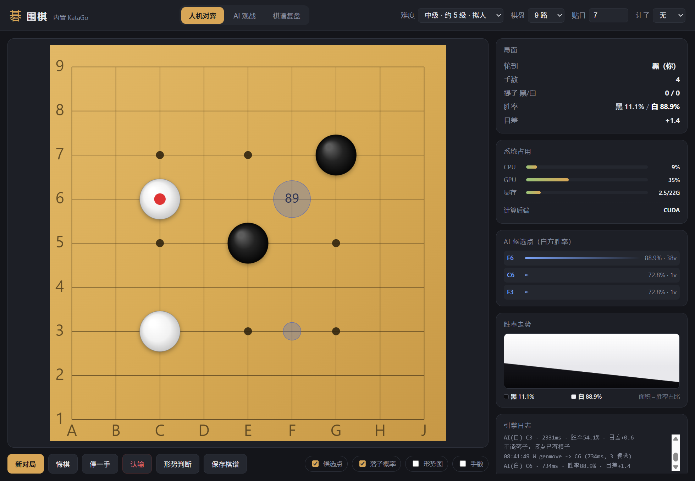

# Komi · 本地 AI 围棋

> **把世界级围棋 AI 装进自己的电脑 —— 完全本地运行，不联网、不调云接口、无遥测。**

Komi 内置 KataGo 引擎与神经网络权重，所有思考都在你本机的显卡上完成：

- **本地 AI 对弈**：10 档可调难度，从「完全新手」到「超越人类」，弱档用真实人类棋谱模型模仿，而不是故意下臭棋
- **本地 AI 观战**：两个引擎实例各执一方互相下，实时看双方落子概率，还能跑 N 局算 ELO 差
- **本地 AI 复盘**：载入 SGF 逐手评估，画出胜率曲线、标出恶手并给出建议着法
- **硬件自适应**：NVIDIA / AMD / Intel 显卡自动选后端（CUDA → ROCm → OpenVINO → DirectML → OpenCL → CPU）

装好即用，断网也能下；一块 96 MB 的安装包，重依赖首次启动按需下载。

    



---

## 目录

- [特性一览](#特性一览)
- [快速开始](#快速开始)
- [三种模式](#三种模式)
- [难度系统](#难度系统)
- [显卡与计算后端](#显卡与计算后端)
- [界面与交互](#界面与交互)
- [目录结构](#目录结构)
- [常用命令](#常用命令)
- [技术实现要点](#技术实现要点)
- [常见问题](#常见问题)
- [更新日志](CHANGELOG.md)
- [授权](#授权)

---

## 特性一览

<table>
<tr><td width="50%" valign="top">

**对弈**
- 10 档难度，弱档用人类棋谱模型模仿真人，而不是"故意下臭棋"
- 9 / 13 / 19 路，贴目可调（默认按尺寸自动取平衡值）
- 让子 2~9 子，坐标由引擎给出标准星位
- 悔棋、停一手、认输、形势判断
- 落子合法性本地二次校验（提子 / 劫 / 自杀）

</td><td width="50%" valign="top">

**观战与复盘**
- AI 对 AI 观战：双方难度独立可选，可暂停 / 即时停止
- 双方落子概率叠加显示（黑环 / 白环 + 百分比）
- 测速对局：交替执黑白跑 N 局，估算 ELO 差
- SGF 打开 / 保存（含让子 `HA/AB`）
- 复盘：逐手胜率曲线 + 恶手标注 + 一键跳转

</td></tr>
<tr><td valign="top">

**工程**
- 显卡后端自动选择：CUDA / DirectML / OpenCL / ROCm / OpenVINO / CPU
- CPU、GPU、显存占用实时监控（NVIDIA 走 nvidia-smi，其它显卡走 WDDM 计数器）
- 引擎崩溃自动重启、配置按内容哈希失效
- 无界面自检模式（`--selftest` / `--spectate` / `--review` / `--ui`）

</td><td valign="top">

**数据**
- 规则引擎单元测试 11 项、SGF 测试 8 项
- 提供 MSI 安装包（96 MB），重依赖首次启动按需下载
- 提供离线完整包（~1.5 GB），拷走即用、完全断网可跑

</td></tr>
</table>

---

## 快速开始

### 环境要求

- Windows 10 / 11（x64）
- 想从源码运行：Node.js 18+（仓库**不含**引擎二进制与权重，首次需 `npm run fetch:engine` 下载约 220 MB）

### 方式一：安装包（推荐给最终用户）

双击 `dist\\Komi-1.0.1.msi`（**96 MB**），安装向导全中文，按 WiX 官方界面规范走四步：

```
欢迎使用 Komi 安装向导
  → 安装范围（为所有人安装 / 仅为我安装）
  → 目标文件夹（默认 %ProgramFiles%\\Komi，点「更改…」可选任意目录）
  → 已准备好安装 → 安装
```

- 默认"为所有人安装"→ 装到 `C:\\Program Files\\Komi`（会请求管理员权限）
- 选"仅为我安装"→ 装到 `%LOCALAPPDATA%\\Programs\\Komi`（免管理员）
- 开始菜单与桌面会创建「Komi」快捷方式，可执行文件是 `Komi.exe`

- 装到 `%LOCALAPPDATA%\Programs\Komi\`（可执行文件是 `Komi.exe`）
- 开始菜单与桌面会创建「Komi」快捷方式
- **不需要选安装目录**：向导一步到底，想换位置见下方"静默安装"

首次启动会先**检测硬件**（显卡型号、厂商、CUDA/OpenCL 可用性），然后按环境列出组件清单：
必需项已勾选，可选加速包按"适用 / 不适用"自动标注，**勾哪些就下哪些**。
默认只需下载约 210 MB，装完自动校验每个后端并进入游戏，之后完全离线。

### 方式二：离线完整包（双击启动）

双击项目根目录的 **`Komi.exe`**（21 KB，自带图标，静默拉起，无命令行窗口）。

启动器会先检查环境，缺东西时弹窗提示而不是闪退：

| 检查项 | 缺失时的行为 |
|---|---|
| `node_modules\electron\dist\electron.exe` | 提示先执行 `npm install` |
| `engine\katago.exe` 或 `engine\cpu\katago.exe` | 提示引擎目录不完整 |

### 方式三：源码运行

```bash
npm install              # 装 Electron 等开发依赖
npm run fetch:engine     # 下载引擎与权重到 engine/（约 220 MB，只需一次）
npm start                # 启动
```

启动后：**你执黑，AI 执白**。点棋盘落子，顶栏可切换模式、难度、棋盘尺寸、贴目、让子。

> 第一次启动会初始化引擎，通常 3~10 秒；AMD / Intel 显卡首次可能 1~3 分钟（见 [显卡与计算后端](#显卡与计算后端)）。

---

## 三种模式

顶栏切换：**人机对弈 / AI 观战 / 棋谱复盘**。

### 一、人机对弈

- 你执黑，AI 执白
- **让子棋**：选 2~9 子后自动贴 0.5 目、由白棋（AI）先行；让子点由 KataGo 的 `fixed_handicap` 给出，保证棋盘与引擎认知一致
- **形势判断**：随时让引擎估算当前比分（不结束对局）
- **保存棋谱**：导出 SGF，让子局会写入 `HA/AB`
- 悔棋一次退回到你上一手之前（自动退 2 手）

### 二、AI 观战

两个**独立引擎进程**各执一方，难度分别可选，适合看不同棋力的差异。

- **速度可选**：观战设置里的「速度」下拉框会同时设定「每手访问」与「落子间隔」，
  手动改这两个数值则自动转为「自定义」。访问数决定棋力（也是耗时的大头），间隔只影响观感：

  | 速度 | 每手访问 | 落子间隔 | 9 路约 |
  |---|---|---|---|
  | 慢慢看 | 200 | 700 ms | ~1.0 秒/手 |
  | 标准（默认） | 60 | 300 ms | ~0.4 秒/手 |
  | 快 | 40 | 120 ms | ~0.2 秒/手 |
  | 极速（同测速） | 40 | 0 | ~0.07 秒/手 |

  以前观战不读「每手访问」，直接用档位自带的值（职业 2000、超人 12000），
  所以同一对局在观战里会比测速慢几十倍——现在两边统一由这个数字决定。
- **开始观战**：支持暂停与**立即停止**（实测约 0.2 秒内停住，不等当前这一手算完）
- **落子概率**：
  - 棋盘上叠加双方候选点——黑方深色圆环、白方浅色圆环，半径 ∝ 概率，高概率点标注百分比
  - 侧栏「落子概率（黑 / 白）」并列显示两方最近一手的候选与概率
- **保存棋谱**：观战过程中随时可存，对局者名自动填为双方难度
- **测速对局**：A、B 交替执黑白跑 N 局，按胜率估算 ELO 差：
  ```
  P = (胜A + 0.5) / (总胜负 + 1)          # 平滑，避免全胜/全负时无穷大
  ELO = -400 · log10(1 / P - 1)          # A 相对 B 的分差
  ```
  - 与观战共用「每手访问」这一项，压低它几局测速几分钟就跑完
  - 自动切**快速模式**（关闭拟人延迟），引擎绑定到 A/B 选手，换边不重启，整场只启动一次

### 三、棋谱复盘

点「打开棋谱」载入 SGF，引擎**逐手评估整盘棋**：

| 项目 | 说明 |
|---|---|
| 评估预算 | 每手 120 访问 / 400ms 上限（达标或超时即停，兼顾质量与速度） |
| 扫描方式 | 前进式扫描（评估 → 落子 → 评估），比分步重放快一个数量级 |
| 胜率曲线 | 沿用黑白面积图，并画出当前手位置的竖线标记 |
| 恶手判定 | 该手让行棋方胜率下降 **≥10%** 记为恶手，**≥25%** 为严重 |
| 恶手展示 | 棋盘红圈（严重者加粗）+ 列表（手数 / 方 / 实际着法 / 亏损 / 建议着法） |
| 导航 | 「上一手 / 下一手 / 下个恶手」+ 键盘 ← →，点击列表项直接跳转 |

长棋谱（几百手）连着跑时，GPU 驱动或内核调优偶尔会让引擎短暂不应答。复盘自带**自愈**：
遇到 GTP 超时或进程退出，会自动重启引擎、重放已评估的前缀、从断点继续（最多 2 次），
状态栏会标注「自动重试 N 次」，不会让整盘作废；非法着法这类问题则立即报错。

支持带让子（`HA`/`AB`）的棋谱。

---

## 难度系统

难度不是简单"少算一点"，而是**网络 × 搜索量 × 拟人度**三者组合：

- **拟人档（入门 ~ 1 段）**：用 KataGo 的 *human SL* 模型（`b18c384nbt-humanv0`）模仿真实业余棋手。
  `humanSLProfile` 支持 20k ~ 9d 的具体段位，棋风像人、会犯人类会犯的错，而不是"AI 特有的怪棋"。
- **强档（3 段 ~ 超人）**：标准网络 + 递增访问数（`maxVisits`），必要时用 `playoutDoublingAdvantage` 微调。

| 档位 | 目标水平 | 实现方式 | 每手耗时（9 路 / 19 路） |
|---|---|---|---|
| 入门 | ~20 级 | human SL `preaz_20k`，纯仿人 | <1s / <1s |
| 新手 | ~15 级 | `preaz_15k` | <1s / <1s |
| 初级 | ~10 级 | `preaz_10k` | ~1s / ~1s |
| 中级 | ~5 级 | `preaz_5k`（对齐 KataGo 官方 5k 配置） | ~1.6s / ~2s |
| 中高 | ~2 级 | `preaz_2k` + 少量搜索 | ~1.5s / ~2s |
| 高级 | ~1 段 | `preaz_1d` + 200 visits | ~2.6s / ~4s |
| 低段 | ~3 段 | 标准网络 150 visits | ~1s / ~2s |
| 高段 | ~5 段 | 标准网络 500 visits | ~1.8s / ~4s |
| 职业 | 职业级 | 标准网络 2000 visits | ~5s / ~12s |
| 超人 | 超越人类 | 标准网络 12000 visits | ~20s / ~60s |

> 耗时是 RTX 2080 Ti 实测参考值；CPU 后端会慢十几倍，只适合弱档位。

**切换机制**：`maxVisits` / `maxTime` / `playoutDoublingAdvantage` 支持运行时热切换；
`humanSLProfile` 是配置级参数，换段位会自动重启引擎（约 2~5 秒）。配置文件按**内容哈希**命名，改了配置自动失效。

---

## 显卡与计算后端

引擎按优先级**自动尝试**，当前用的后端显示在侧栏「系统占用 → 计算后端」。

| 优先级 | 后端 | 适用硬件 | 内置 |
|---|---|---|---|
| 1 | **CUDA** | NVIDIA（cuDNN 9 已随包提供） | ✅ |
| 2 | **ROCm** | AMD 原生（gfx10xx / gfx11xx / gfx12xx…） | ⬜ 自行放置 |
| 3 | **OpenVINO** | Intel 核显 / 独显 / NPU | ⬜ 自行放置 |
| 4 | **DirectML** | 任意支持 DX12 的显卡（AMD / Intel / NVIDIA） | ✅ |
| 5 | **OpenCL** | 任意带 OpenCL 运行时的显卡（AMD / Intel / NVIDIA） | ✅ |
| 6 | **CPU** | 无可用 GPU 时兜底（Eigen） | ✅ |

- **AMD / Intel 用户开箱即用**：自动落到 DirectML 或 OpenCL，无需安装 CUDA。
- **首次初始化较慢**：OpenCL 要调优 GPU 内核、DirectML 要编译模型，**第一次可能 1~3 分钟**，之后有缓存。
  界面会显示"初始化引擎中…（首次使用 OpenCL / DirectML 后端可能需要 1~3 分钟）"。
- **强制指定后端**（排查或对比性能）：环境变量 `GO_BACKEND=opencl`，或命令行 `--backend=opencl`。
  可选值：`cuda` / `rocm` / `openvino` / `directml` / `opencl` / `cpu`。
- **想用更强的后端**：把对应 Windows 构建解压到 `engine/rocm/`、`engine/openvino/` 即可被自动识别，不用改代码
  （KataGo Releases 的 `v1.18.1` 提供这些构建）。

实测（RTX 2080 Ti，9 路）：

| 后端 | 启动 | 每手 |
|---|---|---|
| CUDA | ~2s | ~1.9s |
| OpenCL | ~3s（首次含调优 ~2min） | 0.75s |
| DirectML | ~3s（首次含编译） | 3.6s |
| CPU (Eigen) | ~5s | 3.5s |

---

## 界面与交互

**棋盘**：木纹底、立体棋子、手数标记、最后一手高亮、悬停落子预览。

**侧栏**：

| 卡片 | 内容 |
|---|---|
| 局面 | 轮次 / 手数 / 双方提子数 / 黑白胜率 / 目差 |
| 系统占用 | CPU、GPU、显存占比条 + **当前计算后端**；占用 70% 转橙、90% 转红 |
| AI 候选点 | 按访问数画热力圈，标注胜率（面板写明"白方胜率"避免视角混淆） |
| 落子概率 | 仅观战模式：黑白两方候选与概率并列 |
| 胜率走势 | **纯黑白面积占比**——每列下黑＝黑棋胜率占比，上白＝白棋胜率占比，不画折线 |
| 恶手列表 | 仅复盘模式：手数 / 方 / 着法 / 亏损幅度 |
| 引擎日志 | 引擎事件流（启动、难点、错误） |

**贴目默认值（按尺寸自动套用，实测平衡）**：

| 棋盘 | 默认贴目 | 空盘黑棋胜率（KataGo 4000 访问） |
|---|---|---|
| 9 路 | 7 | 42.3% |
| 13 路 | 7 | 43.4% |
| 19 路 | 7.5 | 37.1%（想执黑更轻松可调到 7） |

**快捷键**

| 按键 | 功能 |
|---|---|
| `Ctrl + Z` | 悔棋 |
| `P` | 停一手 |
| `←` / `→` | 复盘逐手翻页 |

---

## 设置面板（右上角 ⚙）

一个面板管住四件事，全部写进 `%APPDATA%\Komi\config\settings.json`，重启后仍然生效：

### 计算

| 选项 | 说明 |
|---|---|
| **后台计算** | `自动`（有显卡就用显卡）／`仅 GPU`／`仅 CPU`。选「仅 CPU」后引擎只加载 `engine\cpu\katago.exe`，完全不碰显卡；「仅 GPU」在找不到显卡后端时才会退回 CPU |
| **性能模式** | 高吞吐（按核数放大搜索线程与批次）／省电（少量线程、低发热） |
| **当前** | 实时显示后端、线程数、批次与性能档位 |

切换计算方式或性能模式后，引擎会在下一次思考时自动重启，**棋局不会丢**（会重放已下的每一手）。

### 跑分

「测试 GPU」「测试 CPU」用当前神经网络各跑一轮 `katago benchmark`，直接给出**每秒访问数**：

```
✓ GPU · 1072 visits/s · 1064 nnEvals/s · batch 4.6 · 15 线程 · 0.3s
```

跑分期间会暂停正在搜索的引擎，避免两边抢显卡把成绩拉低；两个按钮互斥，同一时间只跑一个。

### 语言

`中文` / `English` 即时切换（含难度名、按钮、卡片标题、状态栏），选择同样持久化。
引擎日志与 KataGo 自身输出保持原文——那些是诊断信息，保持原样便于检索。

### 依赖与组件

列出全部组件（权重、DirectML、OpenCL、OpenVINO、ROCm、CUDA 包）的**已安装 / 未安装 / 不适用**与体积；
「打开组件下载」会重开首次安装向导，这次可以关掉，装完自动刷新状态、不会打断正在下的棋。

### 关于与卸载

显示版本、组件目录、「运行卸载程序」与「打开所在目录」。

---

## 安装与分发

三种形态，按场景选：

| 形态 | 体积 | 适用 |
|---|---|---|
| **MSI 安装包** | **96 MB** | 发给最终用户；首次启动联网下载约 216 MB 组件 |
| **离线完整包**（当前仓库目录） | ~1.5 GB | 无网环境 / 需要 CUDA 满速；解压即用 |
| 源码运行 | 需 Electron | 开发调试 |

### 安装位置与组件目录

安装向导不提供"选择目录"那一页（省掉一步、也免去找不到默认路径的困惑），默认装到
`%LOCALAPPDATA%\Programs\Komi`。需要换位置时用静默安装参数：

```bat
msiexec /i "Komi-1.0.1.msi" /qn APPLICATIONFOLDER="D:\Games\Komi"
```

**下载的组件默认跟着安装目录走**（装在 `<安装目录>\engine\`），装到 D 盘时 250 MB 的权重与后端也落在 D 盘。

组件目录的解析顺序：

| 优先级 | 位置 | 说明 |
|---|---|---|
| 1 | 环境变量 `GO_ENGINE_DIR` | 强制指定，调试用 |
| 2 | 手动选择的目录 | 侧栏「组件目录 → 更改」，记在 `config/paths.json` |
| 3 | 程序自带的 `engine\` | 离线完整包 |
| 4 | **安装目录下的 `engine\`** | 安装目录可写时的默认值 |
| 5 | `%APPDATA%\Komi\engine` | 安装目录不可写时兜底 |

装完也能随时搬家：侧栏「系统占用 → 组件目录 → 更改」选新目录，旧目录已有组件会问要不要
**直接复制过去**（几秒，不用重新下载）。

### 磁盘占用对比（实测）

| 项目 | MSI 精简安装 | 离线完整包 |
|---|---|---|
| 安装包 | 96 MB | — |
| 程序目录 | 283 MB | — |
| 引擎 / 权重（用户数据目录） | 267 MB | — |
| **磁盘合计** | **约 550 MB** | **约 1.5 GB** |

省下来的主要就是 **CUDA + cuDNN（1.1 GB）**：精简安装默认走 DirectML，
AMD / Intel / NVIDIA 通用；只有需要极限速度的 NVIDIA 用户才值得装 CUDA。

### 组件清单（安装向导里按环境自动勾选）

| 组件 | 体积 | 条件 | 说明 |
|---|---|---|---|
| 主力神经网络 `b18c384nbt` | 93 MB | 必需 | 对弈强度基础 |
| 拟人神经网络 `humanv0` | 95 MB | 必需 | 10 档难度里的"拟人"段位 |
| **DirectML** 后端 | 23 MB | 必需 | AMD / Intel / NVIDIA 通用（DX12），精简安装的默认后端 |
| **OpenCL** 后端 | 6 MB | 可选 | 老显卡 / 核显兜底（AMD、Intel 默认勾选） |
| **OpenVINO** 后端 | 83 MB | 可选 | 仅 Intel；通常比 DirectML 快 |
| **ROCm** 后端 | 207~211 MB | 可选 | 仅 AMD 原生；按显卡架构自动区分 gfx103X / gfx110X |
| **CUDA 加速包** | ~1.2 GB | 可选 | 仅 NVIDIA；KataGo CUDA 版 + cuDNN + CUDA 运行库，速度约为 DirectML 的 2 倍 |

**环境检测做了什么**：读取显卡型号（CIM/WMI）→ 判断厂商 → 结合 `nvidia-smi`、
CUDA Toolkit、OpenCL 运行库是否存在 → 给每个可选组件算"适用 / 不适用 / 推荐"。
不适用的会灰掉并写明原因（例如"未检测到 AMD 显卡"），不会让用户下错东西。

**装完还会自检**：逐个后端跑一次 `katago version`，确认 DLL 齐全、后端能加载，
结果显示在向导里（如 `DirectML 可用（ONNX Runtime）`）。

下载带进度、大小校验，装在 `%APPDATA%\Komi\engine`，装完自动清理缓存。

### 一块 96 MB 的安装包如何覆盖所有显卡

| 你的显卡 | 向导自动推荐 | 装完实际用的后端 |
|---|---|---|
| NVIDIA（RTX/GTX） | DirectML + 可选 CUDA 包 | DirectML；勾了 CUDA 包则自动优先 CUDA（快约 2 倍） |
| AMD Radeon RX 7000/9000 | DirectML + OpenCL + ROCm(gfx110X) | DirectML；装了 ROCm 则优先 ROCm |
| AMD Radeon RX 6000 | DirectML + OpenCL + ROCm(gfx103X) | 同上 |
| Intel Arc / Iris / 核显 | DirectML + OpenCL + OpenVINO | 装了 OpenVINO 优先 OpenVINO，否则 DirectML |
| 只有核显 / 无独显 | DirectML 或 OpenCL | 同上（弱档位可用） |
| 什么都不支持 | — | 自动回退 CPU（Eigen，仅弱档位） |

后端优先级固定为 CUDA → ROCm → OpenVINO → DirectML → OpenCL → CPU，
所以**装了更快的组件不用改配置，下次启动自动用上**。

### 想要 CUDA 满速？

把离线完整包里的这些文件拷进 `%APPDATA%\Komi\engine\`，下次启动会自动优先选 CUDA：

```
katago.exe            # CUDA 版
cudnn*.dll            # cuDNN 9 运行库
```

（还需要系统里有 CUDA 12 运行库，即 `cudart64_12.dll` 与 `cublas*`，通常随 CUDA Toolkit 安装。）

### 性能模式（高吞吐 / 省电）

右上角「性能」下拉框，随时可切，选择会记在 `%APPDATA%\Komi\config\settings.json`：

| 档位 | 搜索线程 | NN 批次 | NN server 线程 | 适合 |
|---|---|---|---|---|
| **高吞吐**（默认） | ⌊(核数−1) ÷ 引擎数⌋，上限 16 | CUDA 24 / 其它 8 | CUDA 2 | 有独显，想要更强的实时分析 |
| 省电 | 6（观战 4） | 8 | 1 | 笔记本、核显、想让风扇安静 |

实测（RTX 2080 Ti + b18c384nbt，19 路，2000 访问）：省电 6 线程 ≈ **520～610 visits/s**，
高吞吐 15 线程 ≈ **1235～1250 visits/s**，约 2 倍。观战是双引擎同跑，线程按核数平分（16 核 → 各 7）。

**切换会重启引擎**——中断中的对局不会丢：引擎管理器记录了每一手，重启后自动重放恢复
（`--perf-test` 会验证「往已有棋子处落子被拒绝」）。观战/测速进行中不允许切换，避免两台引擎状态不一致。

#### 为什么 CUDA 占用率看起来不高？

这不是优化问题，是 KataGo 的固有形态：

- GPU 只负责**算神经网络**（policy / value / ownership），搜索树（PUCT、选点、劫争合法性）全在 CPU 上串行推进；
- 于是 GPU 的节奏是「等 CPU 凑一批 → 算 3~5 毫秒 → 再等」，`nvidia-smi` 那 1 秒窗口的百分比自然偏低；
- 真正决定效率的是**批大小**。官方 benchmark 实测：平均 batch 2.5 时 326 nnEvals/s，batch 39 时 1537 nnEvals/s
  ——**同样的卡，靠攒批快 4.7 倍**。高吞吐模式就是加线程把批喂满；
- 低档位（入门 40 访问）本身就是 30~50 毫秒的短促突发，任何一秒粒度的占用率曲线都抓不到。

所以判断优化好坏请看 **visits/s**：状态栏「搜索线程」显示当前实际参数，引擎日志里也有
`搜索参数：15 线程 · batch 24 · NN server 2（性能模式）`。

### 卸载

**便携版 / 免安装目录**：根目录里的「**卸载 Komi.exe**」（或 `Uninstall-Komi.exe`）双击即可，
弹窗里可以勾「同时删除 AI 组件与神经网络」。它会先结束正在运行的 Komi / katago 进程、清理桌面与
开始菜单快捷方式，再删掉整个程序目录（借道临时副本删掉自己）。

支持命令行静默卸载：

```bash
"卸载 Komi.exe" --silent            # 静默卸载，保留 %APPDATA%\Komi
"卸载 Komi.exe" --silent --remove-data   # 连组件与神经网络一起删
```

**MSI 安装版**：用「设置 → 应用 → Komi」或下面的命令（安装目录归 MSI 管，别手动删）：

```bash
npm run dist:uninstall
```

两种方式都**不会**默认删除 `%APPDATA%\Komi`（权重可复用）；要彻底清理，勾选「同时删除 AI 组件」或手动删该目录。

**Linux**：包内有 `uninstall.sh`（`--keep-data` 保留组件，`--system` 删系统级安装）。

### 自己打包

```bash
npm run dist          # 同时产出 MSI 与免安装目录
npm run dist:msi      # 只出 MSI（输出到 dist/）
npm run dist:dir      # 只出免安装目录（dist/win-unpacked）
```

打包配置见 `build/electron-builder.yml`：通过 `files` 白名单**排除 `engine/`**，
只保留中英文语言包（省约 40 MB）。

---

## 目录结构

```
Komi/
├── Komi.exe              # 双击启动器（21 KB，带图标）
├── 卸载 Komi.exe         # 卸载程序（27 KB；Uninstall-Komi.exe 是同一份）
├── docs/preview.png          # 界面预览图
├── assets/app.ico            # 应用图标（构建脚本生成）
├── engine/                   # 引擎与权重（约 1.4 GB，**不入库**；npm run fetch:engine 获取）
│   ├── katago.exe            # CUDA 版（NVIDIA）
│   ├── cudnn*.dll            # cuDNN 9 运行库（CUDA 版必需）
│   ├── directml/             # DirectML / ONNX Runtime 版
│   ├── opencl/               # OpenCL 版
│   ├── cpu/                  # Eigen CPU 版
│   └── weights/
│       ├── b18c384nbt.bin.gz           # 主力网络
│       └── b18c384nbt-humanv0.bin.gz   # 拟人网络（human SL）
├── src/
│   ├── main/                 # 主进程
│   │   ├── main.js           # 窗口、IPC、自检与截图模式
│   │   ├── engineManager.js  # 引擎生命周期、后端选择、对局语义、复盘扫描
│   │   ├── gtp.js            # GTP 客户端（进程管理、串行队列、分析流解析）
│   │   ├── spectate.js       # AI 对 AI 观战与 ELO 测速
│   │   ├── difficulty.js     # 10 档难度定义与配置生成
│   │   ├── components.js     # 运行组件按需下载与安装（安装包瘦身的关键）
│   │   ├── metrics.js        # CPU / GPU / 显存采样
│   │   └── preload.cjs       # contextBridge 白名单 API
│   ├── renderer/             # 棋盘 UI（Canvas + 原生 JS，无框架）
│   │   ├── index.html
│   │   ├── app.js            # 界面逻辑（三种模式 + 设置面板）
│   │   ├── i18n.js           # 中英文案字典（data-i18n / T()）
│   │   ├── styles.css
│   │   └── rules.global.js   # 由 shared/board.js 生成（启动时自愈）
│   └── shared/
│       ├── board.js          # 规则引擎（提子/劫/自杀/数子/让子）
│       ├── sgf.js            # SGF 解析与生成
│       └── buildRulesGlobal.js  # 规则引擎 → 渲染进程脚本
├── build/electron-builder.yml # 打包配置（MSI / 免安装目录）
├── dist/                     # 打包输出（MSI 与 win-unpacked）
├── tools/
│   ├── launcher/launcher.cs   # 启动器 C# 源码
│   ├── launcher/uninstall.cs  # 卸载程序 C# 源码
│   ├── build-launcher.ps1     # 生成图标 + 编译两个 exe
│   ├── make-uninstaller-alias.mjs # 生成「卸载 Komi.exe」中文名副本
│   ├── build-renderer.mjs     # 生成 rules.global.js
│   └── fetch.mjs              # 离线下载工具（换权重/引擎用）
├── scripts/                  # 单元测试与自检脚本
└── config/                   # 运行时生成（GTP 配置、后端记录）
```

---

## 常用命令

```bash
# 运行
npm start                     # 启动应用
npm run dev                   # 启动并打开开发者工具

# 打包/构建
npm run dist                  # 打包 MSI + 免安装目录（输出到 dist/）
npm run dist:msi              # 只打 MSI 安装包
npm run exe                   # 重新编译「Komi.exe」（离线完整包用的启动器）
npm run build:renderer        # 重新生成 renderer/rules.global.js

# 测试
npm run fetch:engine          # 下载引擎与权重到 engine/（--cuda 加 CUDA 包，--mirror china 走镜像）
npm run test:rules            # 规则引擎单测（11 项）
npm run test:sgf              # SGF 解析/生成单测（8 项）
npm run test:perf             # 性能模式参数单测（15 项：线程/批次/cfg 内容/配置指纹）
npm run test:review           # 复盘自愈测试（注入一次 GTP 超时，验证重启续跑；需引擎）
npm run smoke                 # 引擎冒烟测试（握手/参数/分析流/拟人模型）
npm run selftest              # 无界面全链路自检（新局→落子→难度切换→数子）
npm run perf:engine           # 无界面：高吞吐 vs 省电吞吐对比 + 引擎重启后局面恢复校验
npm run gen:sgf               # 用两个引擎下一局并导出 SGF 到 .tmp/
npm run shot                  # 启动、自动走几手并截图到 .tmp/shot.png（--shot-plain 截空盘）
```

**无界面自检模式**（在 Electron 内跑，不弹窗）：

```bash
electron . --selftest                     # 核心链路
electron . --handicap                     # 让子棋（2 子 / 4 子）
electron . --spectate                     # 观战一局 + 4 局 ELO 测速
electron . --perf-test                    # 性能模式吞吐对比 + 局面恢复校验
electron . --review .tmp/test-game.sgf    # 复盘：逐手评估 + 恶手
electron . --ui                           # 三种模式的 UI 级验证
```

---

## 技术实现要点

1. **一次搜索拿到全部信息**
   用 `kata-genmove_analyze`（而不是 `genmove` + `kata-analyze`），一次搜索同时得到着法、候选点
   （visits / winrate / scoreLead / prior / pv）和 ownership 形势图。

2. **KataGo 的输出格式有两个坑**
   - 整盘分析会**挤在一个 GTP 响应正文里**（多个 `info move` 段），没有 `rootInfo` 行；
     根节点胜率要取该行 `order 0` 的候选。
   - `pv` 与 `ownership` 都是**空格分隔**，不是逗号。

3. **规则双保险 + 精确劫判定**
   UI 层用自己的规则引擎校验每一手（提子 / 劫 / 自杀 / 让子），引擎侧另有判断。
   劫的判定必须精确：只有"提掉一子且提子方自己只剩一口气"才是劫——
   早期版本把所有单子提吃都当劫，直接导致观战里引擎的合法着法被本地规则判为非法。

4. **难度 = 网络 × 搜索 × 拟人度**
   弱档靠 human SL 模型而不是"故意下臭棋"；强档靠访问数堆强度；
   换段位重启引擎、换搜索参数热切换，两者分开处理。

5. **引擎后端自动选择**
   每个后端有各自的启动超时（OpenCL 首次调优最长可到 7 分钟）与专属配置
   （DirectML/OpenVINO 必须写 `onnxProvider`），失败自动降级到下一个后端。

6. **GPU 占用跨厂商**
   NVIDIA 走 `nvidia-smi`；其它显卡改用 Windows WDDM 的 `GPU Engine(*)` 计数器
   （常驻 `typeperf` 流式采样，汇总 3D / Compute 引擎实例），AMD / Intel 一样有数值。

7. **ELO 估算**
   `P = (胜A + 0.5) / (总胜负 + 1)`，`ELO = -400·log10(1/P - 1)`；
   用 +0.5/+1 平滑，避免 4:0 这类结果算出正无穷。

---

## 常见问题

**Q：没有 NVIDIA 显卡能用吗？**
能。按 CUDA → ROCm → OpenVINO → DirectML → OpenCL → CPU 自动回退，AMD / Intel 开箱可用。
只有所有 GPU 后端都不可用时才退到 CPU（只有弱档位跑得动）。

**Q：第一次启动卡在"初始化引擎中…"？**
OpenCL 首次要调优内核、DirectML 首次要编译模型，1~3 分钟属正常，之后有缓存。

**Q：切换 9 路后第一手特别慢？**
KataGo 会按棋盘尺寸重建神经网络缓冲，第一手慢几秒，之后正常。

**Q：提示缺少 `cudnn64_9.dll`？**
CUDA 版依赖 `engine/` 根目录下的 cuDNN DLL，别单独移动 `katago.exe`。缺了会自动降级到其它后端。

**Q：能换更强的网络吗？**
把新权重放进 `engine/weights/`，改 `src/main/engineManager.js` 里的 `models.main` 路径即可
（例如 `b28c512nbt` 更强但更吃显存）。`tools/fetch.mjs` 可离线下载权重。

**Q：安装包为什么只有 96 MB，装完却占 550 MB？**
安装包只含程序本体。首次启动会下载两套神经网络（188 MB）与 GPU 后端（29 MB）到
`%APPDATA%\Komi`，这部分可复用、卸载不删。

**Q：精简安装后想换成 CUDA 满速？**
把离线完整包里的 `katago.exe` 与 `cudnn*.dll` 拷进 `%APPDATA%\Komi\engine\`，
重启后会自动优先选 CUDA（需要系统装有 CUDA 12 运行库）。

**Q：没有网络能做首次安装吗？**
可以，但请直接用**离线完整包**（当前目录），它已内置引擎与权重，完全不需要联网。

**Q：软件叫什么？界面是中文吗？**
英文名 **Komi**（日语"棋盤"，围棋玩家一眼就懂），中文界面完整保留，标题栏写作 `Komi · 内置 KataGo`。
桌面/开始菜单快捷方式、安装目录、可执行文件都叫 `Komi`。

**Q：AI 观战里「保存棋谱」点不动？**
0.3.3 已修复：观战每落一手没有刷新按钮状态，导致按钮一直停在 disabled。现在落子后会实时刷新。

**Q：AI 观战点了没反应？**
0.3.1 已修复：打包版里观战的两个引擎实例之前沿用了"随包路径"，装好之后会去
`resources\engine`（不存在）和只读的 asar 里找引擎/写配置，导致引擎起不来且界面无提示。
现在观战引擎和主引擎一样使用用户目录（`%APPDATA%\Komi\engine`）。

**Q：数据会上传吗？**
不会。全程离线，不联网，不写遥测。

---

## 授权

- **KataGo 引擎为 GPLv3**；本项目以独立进程 + GTP 通信的方式集成。
- 神经网络权重的授权条款以其[发布页](https://katagotraining.org/)为准，**商业分发前请自行确认**。
- 自用 / 开源学习无虞。

---

## 路线图

- [x] 内置 KataGo、10 档难度、9/13/19 路
- [x] 胜率面积图、候选点、形势判断
- [x] SGF 读入与复盘（逐手胜率曲线、恶手标注）
- [x] AI 对 AI 观战（双引擎 + ELO 测速）
- [x] 让子棋
- [x] AMD / Intel 显卡支持（DirectML / OpenCL）
- [x] 跨厂商 GPU 占用监控
- [x] MSI 安装包 + 运行组件按需下载（安装包 96 MB）
- [ ] 复盘时并列显示"实战 vs AI 建议"的变化图
- [ ] 多局对局的本地棋谱库
